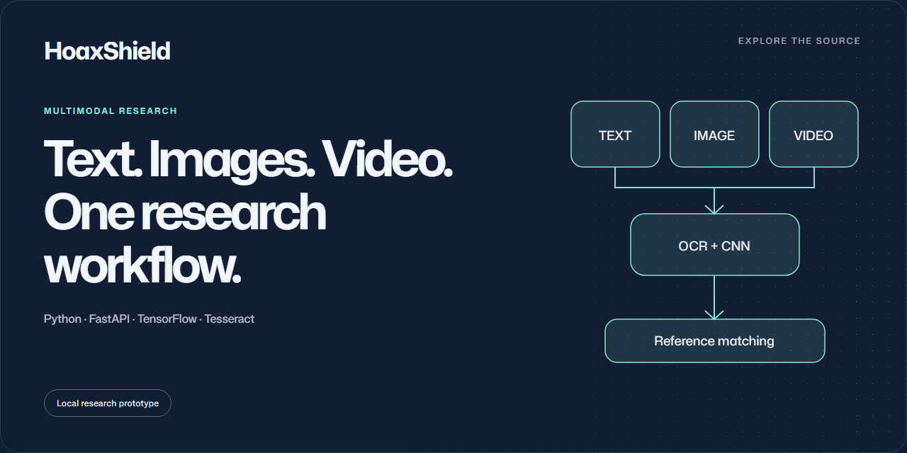

# HoaxShield

An Indonesian-news research prototype combining a multi-kernel CNN, OCR and reference-article similarity search.

**Python · FastAPI · TensorFlow · Tesseract** · Local research prototype

## Research workflow

1. Provide article text, an image or a video.
2. Extract text with OCR when needed and apply the model's preprocessing.
3. Inspect the classification and related reference articles.

Predictions are research outputs, not verified facts. Reference matching may
adjust the CNN label. Reported model accuracy has not been independently reproduced.

## Run locally

Use **Python 3.11** in a virtual environment, activate it, then install the API
dependencies from the repository root:

```sh
python -m pip install -r apps/api/requirements_core.txt
cd apps/api
python -m uvicorn app.main:app --host 127.0.0.1 --port 8000
```

Open **http://127.0.0.1:8000**. Inference requires the matching trusted model and
tokenizer in <code>apps/api/app/assets/</code>. Install Tesseract and configure its
executable/data paths for your OS before using OCR. See [training notes](TRAINING_COLAB.md).

## API

| Endpoint | Purpose |
| :-- | :-- |
| <code>GET /api/health</code> | Model/service status |
| <code>POST /api/predict</code> | Text, image or video prediction |
| <code>GET /api/dataset</code> | Reference-dataset status |

## Checks

```sh
node --test tests/evidence-security.test.cjs
python -m pip install httpx==0.28.1
python -m unittest discover -s tests -p 'test_*.py' -v
```

These checks use test doubles for models, datasets and OCR; they do not reproduce
model accuracy or exercise a full OCR installation.

## Deployment boundary

Keep this prototype local. The upload endpoint has no authentication or rate
limiting; multipart parsing limits, OCR timeouts and deployment controls require
review before public hosting. Never load untrusted pickle/joblib model files.
Read [SECURITY.md](SECURITY.md).
